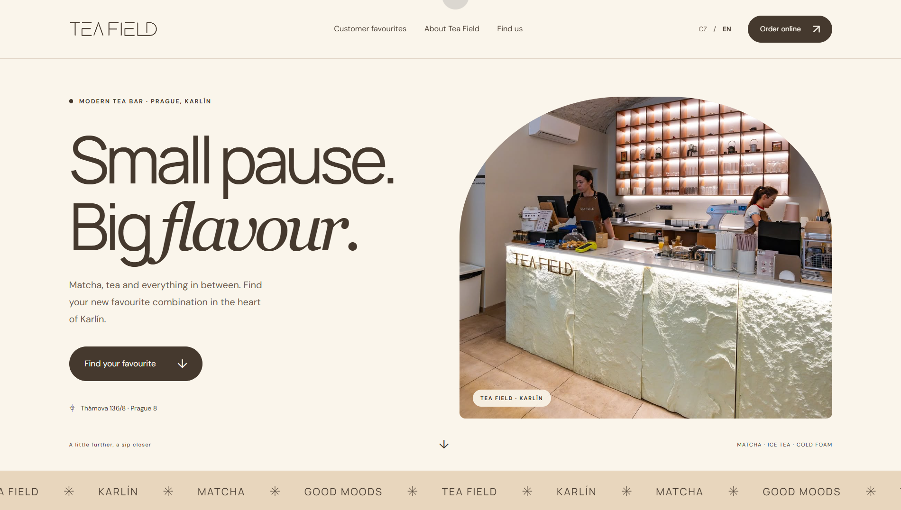
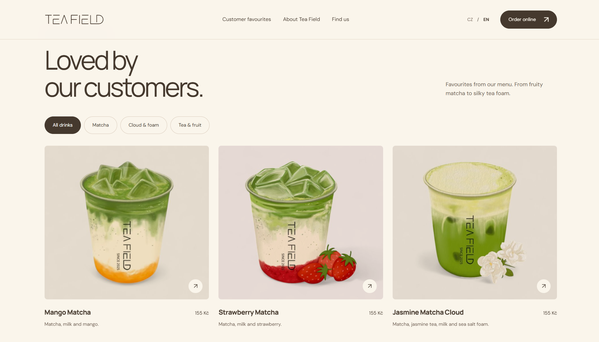
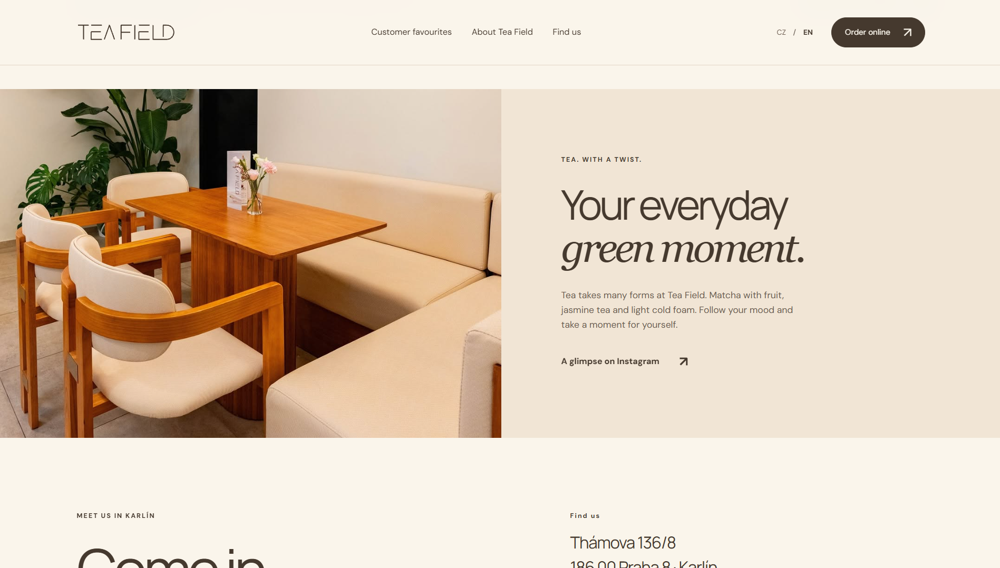
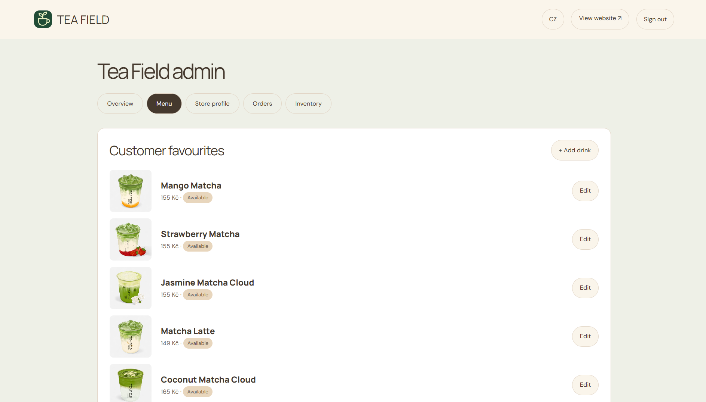

# Tea Field

[View the Tea Field storefront on GitHub Pages](https://cheletoyaold.github.io/teafield.io/)

The Pages edition shows a snapshot of the public menu. Run the full application locally to use the staff dashboard.

A bilingual website for Tea Field, a modern tea bar in Prague’s Karlín district. Guests can browse drinks in Czech or English, find the bar and order through its delivery provider. Staff use a separate dashboard to keep the menu, store details, orders and inventory up to date.



[Run on Windows](#run-on-windows) · [Create an administrator](#create-an-administrator) · [Explore the project](#explore-the-project)

## Run on Windows

1. Install **Node.js 24 or later** with npm.
2. Download and extract the project, or clone the repository. Open PowerShell in the folder containing `package.json`.
3. Start the server with the command below. The application uses Node’s built-in SQLite support and has no npm dependencies to install.

```powershell
npm.cmd start
```

**[Open the local website](http://127.0.0.1:3000/)** in your browser. Keep the PowerShell window open while using the site. Press **Ctrl+C** to stop the server.

## Create an administrator

Open a second PowerShell window in the same project folder. Choose a username and a password of at least 12 characters. The password prompt hides your input.

```powershell
$env:ADMIN_USERNAME = Read-Host 'Administrator username'
$secret = Read-Host 'New password (at least 12 characters)' -AsSecureString
try {
    $env:ADMIN_PASSWORD = [System.Net.NetworkCredential]::new('', $secret).Password
    npm.cmd run admin:create
} finally {
    Remove-Item Env:ADMIN_PASSWORD, Env:ADMIN_USERNAME -ErrorAction SilentlyContinue
    $secret.Dispose()
    Remove-Variable secret
}
```

Once the command confirms that the account was created, [open the local admin dashboard](http://127.0.0.1:3000/admin) and sign in.

## Explore the project

### Customer favourites

Guests can filter the menu by category and compare ingredients and prices before choosing a drink.



### Inside the tea bar

The café section introduces the space and leads visitors to the address, directions and Instagram profile.



### Behind the counter

Staff can add drinks, replace photos, update prices and change availability. The Orders and Inventory tabs keep manual records in the same dashboard.



## Hosting and backups

The full site needs **Node.js 24+**, HTTPS and persistent storage for SQLite. GitHub Pages serves static files and cannot run the menu API or admin dashboard. Production settings are listed in [.env.example](.env.example).

By default the application stores its database and uploaded images in `data/`. To back up the site, stop the server and copy the entire directory. Local data and credentials are excluded from Git.
